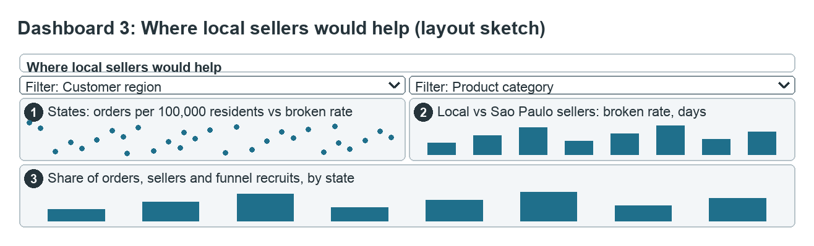

# Olist Delivery Promise: Dashboard Design Document

MGTA 457 Business Intelligence Systems, Fall 2026. Team: AJ, Ruby, Merna.

Version of 2026-11-19. The data checks ran in Databricks. The other numbers come from planning queries on the same raw files, which our Gold tables will reproduce.

## The question

Olist lets small Brazilian shops sell on the big online marketplaces through one contract, and its carrier partners deliver the orders. At checkout every customer sees a promised delivery date. We ask: where does Olist break that promise, what does a broken promise cost, and what should Olist fix first?

The dashboards build up to a three-part answer. Broken promises are 8.6% of orders but 36.7% of the 1 and 2 star reviews. One route, Sao Paulo to Rio de Janeiro, breaks more promises above the national rate than the next nine routes together. And promising later dates would fix less than a quarter of the problem, so the fix has to be on the routes themselves.

## Who uses it

We designed for three readers, one dashboard each, in the order of the story: what it costs, where it happens, and what to change. The Head of Customer Experience owns review scores and customer messages, and asks how much of the bad-review pile follows a broken promise. The Head of Logistics owns the carriers and the promised-date model, and decides which routes get fixed next quarter and how. The Head of Seller Acquisition runs the funnel that signs new sellers, and asks where sellers close to the customers would shorten deliveries.

## The data behind the dashboards

We combine three datasets from two publishers: the Olist marketplace data (99,441 orders from September 2016 to October 2018, in nine tables), the Olist marketing funnel (8,000 shops that asked to join and the 842 that signed), and IBGE, Brazil's statistics office (the 2018 population of the 27 states and its official list of states and regions). All 13 files are loaded unchanged into `olist.raw` in Databricks, every column as text, and the 23 queries of our profiling script returned the values we expected. The data has the problems the class tutorials prepared us for:

- **Several grains.** An order has its own items, payments and reviews. Joining items to payments repeats items and adds 4.6% to their value; joining customers to the raw location table turns 99,441 customers into 15 million rows.
- **Keys that do not line up.** IBGE numbers its states and Olist uses two letters, so IBGE's list of states is the bridge. Only 380 of the 842 signed sellers appear in the orders.
- **Copies and conflicts.** 261,831 location rows are exact copies, and 547 orders have more than one review, 202 of them with different scores. We keep the latest review.
- **A definition that changes the answer.** The promised date has no time of day, so comparing timestamps calls 1,292 deliveries late that arrived on the promised day. We compare days.
- **A window that ends early.** Deliveries stop being recorded after August 2018: 8,314 that month, 56 in September, 3 in October. We judge a promise only once its day has passed inside the data, so we keep orders bought from January 2017 and promised by August 31, 2018: 95,901 orders, not counting canceled or unavailable ones.

Silver will apply 31 rules, each with its reason in the data quality log, and set aside the rows it cannot trust in a quarantine table. Gold is a star schema. `fact_orders` has one row per order: its promise, delivery, outcome, latest review, and its route when one seller shipped the whole order. `fact_order_items` has one row per item, with its seller, product and the seller's deadline to hand it to the carrier. They share the dimensions date, state (with the IBGE region and population), seller (with the funnel channel for sellers who came through it) and product (with the English category). A metric view holds the rates, so a filter recalculates a rate instead of reading a stored one. The dashboards read only Gold tables and metric views.

## Metric definitions

| Metric | Definition |
| --- | --- |
| Promised day | The estimated delivery date shown at checkout. It is a day with no time |
| Broken promise | The order was not delivered by the end of the promised day: it arrived on a later day, or had still not arrived when the day passed. Canceled orders are left out |
| Broken-promise rate | Broken promises divided by orders, for orders bought from January 2017 and promised by August 31, 2018 |
| Low review | The order's latest review gives 1 or 2 stars |
| Reviewed before arrival | The customer answered the review before the parcel was delivered |
| Route | Seller state to customer state, for orders shipped by a single seller |
| Excess broken promises | A route's broken promises minus what the national rate (8.7% on single-seller orders) predicts for its number of orders |
| Margin of error | The 95% interval of a rate, shown as plus or minus percentage points |
| Busy month | A month whose national broken-promise rate is at least twice the median month (6.85%) |
| Fix type | Lasting fix when the route's rate outside busy months, minus its margin, is above the national 6.4%; busy-season plan when its excess in busy months is larger than in the other months; both when both hold |
| Orders per 100,000 residents | A state's orders divided by its 2018 IBGE population |
| Local seller | A seller in the same state as the customer |

## Dashboard 1: What broken promises cost

This page is for the Head of Customer Experience. Three cards open it. 8.6% of orders broke their promise (1). 36.7% of the 14,205 reviews of 1 or 2 stars in our window followed a broken promise (2). And 70.1% of the reviews of late orders were written before the parcel arrived (3). A bar chart (4) shows the score falling right after the promised day: 4.03 on the day itself, 3.29 one to three days late and 2.10 four to seven days late, while early orders stay between 4.20 and 4.32. A second chart (5) compares orders that took the same number of days to arrive. In every band the late ones score lower: by 0.4 stars in the fastest band, which holds only 74 late orders, and by 1.0 to 1.8 stars in the others. So the score follows the promise, not only the speed. These are correlations, and the page says so. They point at one cheap test. Reviews of late orders written before arrival average 1.65 stars, against 3.72 after it, so the test is a delay notice with a new date, sent before the review survey to customers whose parcel will miss.

## Dashboard 2: Where promises break

This page is for the Head of Logistics, and it ends in a ranked list. The table (1) ranks routes by their excess broken promises. Sao Paulo to Rio de Janeiro comes first: 8,071 orders, 17.1% broken (plus or minus 0.8 points), 678 above what the national rate predicts. That is more than the next nine routes together (629). Five of the top ten go into the Northeast and two into Rio, while Sao Paulo to Minas Gerais, the other big route, does better than the national rate (6.7%). Each route also gets a fix type from a rule in SQL. Sao Paulo to Rio needs both a lasting fix and a busy-season plan. Sao Paulo to Bahia, Pernambuco and Piaui need a lasting fix. Parana to Rio and Sao Paulo to Santa Catarina need a busy-season plan.

The line chart (2) shows why there are two kinds of fix. The Northeast breaks promises in ordinary months too: 11.7% in 2017 and 13.2% in 2018, against 4.8% and 5.1% for the Southeast without Rio. Three months are different. In November 2017, February 2018 and March 2018 the national rate was 14.0%, 15.0% and 20.8%. Those months hold 22.2% of orders but 42.9% of broken promises. Rio reached 33.4%, and the promised dates were about as long as in other months. The bar chart (3) tests the obvious idea of simply promising later dates. Only 22.7% of broken promises missed by one to three days, so a promise three days later would bring the rate from 8.6% down to just 6.6%. In the Northeast, where a late order typically arrives 8 days late, it would rescue fewer than 1 in 5. The last chart (4) shows where the days go: 72.2% of late deliveries were handed to the carrier by the seller's deadline, so most of the delay happens after the handover.

The dashboard has a second page, "Can we trust it", next to the list. It shows every check and Silver rule with the rows kept, flagged and set aside (5), and the rows set aside by reason (6). It also shows the deliveries recorded per month, which is why the analysis stops in August 2018 (7), and the broken-promise rate of each region with its margin (8).

## Dashboard 3: Where local sellers would help

This page is for the Head of Seller Acquisition. The scatter plot (1) puts each state's orders per 100,000 residents, using IBGE's population, against its broken-promise rate. Rio de Janeiro stands out. In the 12 months to August 2018 it bought 56.4 orders per 100,000 residents, close to Sao Paulo's 71.7. But it has 8.5 active sellers per million residents against Sao Paulo's 35.2, and 91.5% of its orders came from another state. The bar chart (2) compares sellers in the customer's state with sellers in Sao Paulo. For Rio customers, local sellers broke 7.7% of promises (plus or minus 1.7) and delivered in a median of 5 days, against 17.1% and 13 days for Sao Paulo sellers. But local sellers shipped only 7.8% of Rio's orders. Outside Sao Paulo, sellers in the customer's own state were faster in all 43 comparisons of the same state and product category. The last chart (3) shows that the funnel recruits where sellers already are. 61.1% of the funnel sellers who sold are in Sao Paulo, close to the 59.7% of all sellers, while Rio, with 12.7% of orders, got 6.8% of them. The decision is a measured recruiting pilot in Rio. The gaps are correlations, since local sellers may sell different products, so the pilot has to prove the speed before anyone counts on better reviews.

## Why these charts

We kept to five chart types and gave each one job. A card shows a single headline number. Bars compare groups: score by days late, regions, local and distant sellers. A line shows rates moving over months. The scatter puts two measures of the same state against each other. A table carries the ranked routes, because a logistics lead needs names and reasons, not shapes. Broken promises have one color on every page, and every rate with a margin of error shows it. The three dashboards hold 16 visuals in all, against the syllabus minimum of three dashboards and six visuals. The figures are layout sketches drawn from our dashboard plan, and their numbers match the text.

## User flow and filters

Each reader has a starting point. The Head of Customer Experience opens Dashboard 1 to see how much of the bad-review pile follows a broken promise, and moves to Dashboard 2 when the share is high. The Head of Logistics starts on Dashboard 2, reads the routes table from the top, and sees for each route whether it needs a lasting fix, a busy-season plan, or both. The Head of Seller Acquisition starts on Dashboard 3, picks a state with few nearby sellers, and checks whether the funnel recruits there. Anyone can open "Can we trust it". All three dashboards have a customer-region filter. Dashboards 1 and 2 add the purchase month, Dashboard 2 the seller state, and Dashboards 1 and 3 the product category. The fix type ignores the month filter, because it compares the busy months with the rest of the year.

## What the data can and cannot say

The data has no carrier name, tracking event or address, so why Sao Paulo to Rio breaks remains a question for Olist and its carriers. Every link between promises and reviews is a correlation. We found the busy months by looking at the data, so the rule that defines them will be judged on new months. The 1,278 orders shipped by several sellers have one carrier date, so they stay in the totals but not in the routes. The data stops in August 2018, so we deliver a pipeline and rules that a monthly refresh would rerun, not a list for today. Only 380 of the 842 signed sellers appear in the orders and the leads carry no location, so the funnel tells us where recruits sell, not how every channel performs.

## Fairness

Region and state describe where the problem is. They never rank a seller. Customers in the Northeast do get worse service: 15.6% of their promises broke, against 7.8% in the Southeast. The dashboards show that gap with its margin instead of hiding it, and the fixes aim at routes and carriers, not at customers. If Olist later scores sellers, it should use only the part a seller controls, the handover to the carrier, because arrival depends on where the customer lives.

## What comes next

Following the professor's Silver steps, we inspected every table, stated its grain and key, measured how a join on the wrong grain inflates rows, and drafted 31 rules and seven assumptions, each with its reason. Next, the team confirms the rules, then we build Silver, Gold, the metric view, the checks and the dashboards before the code freeze on December 3.
