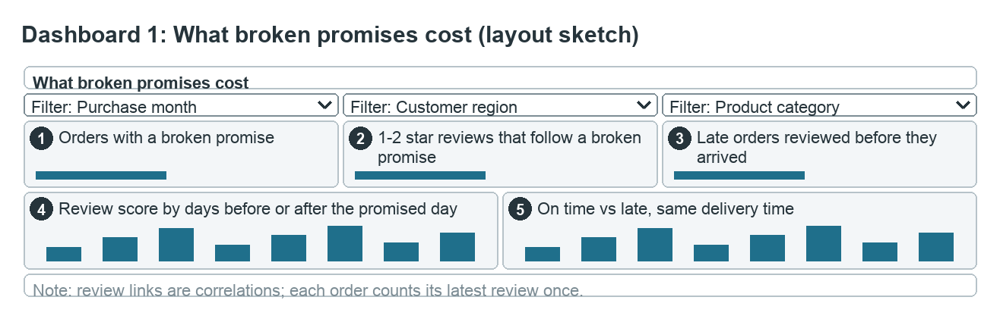
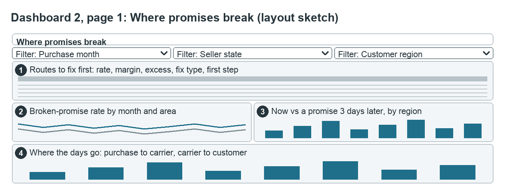
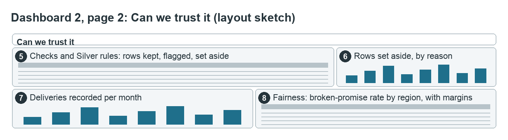
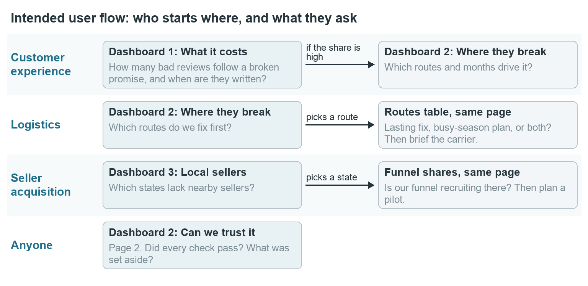

# Olist Delivery Promise: Dashboard Design Document

MGTA 457 Business Intelligence Systems, Fall 2026. Team: AJ, Ruby, Merna.

Version of 2026-11-24. The data facts come from our profiling script; every result is recomputed from our Gold tables by the view `design_doc_numbers`.

## The question

Olist lets small Brazilian shops sell on the big online marketplaces through one contract, and its carrier partners deliver the orders. At checkout every customer sees a promised delivery date. We ask: where does Olist break that promise, what does a broken promise cost, and what should Olist fix first?

The dashboards build up to a three-part answer. Broken promises are 8.6% of the orders we judge but 36.7% of the orders with a 1 or 2 star review. One route, Sao Paulo to Rio de Janeiro, breaks more promises above the national rate than the next nine routes together. And a promise three days later would fix less than a quarter of the problem, so the fix has to start on the routes themselves.

## Who uses it

We designed for three readers, one dashboard each, in the order of the story: what it costs, where it happens, and what to change. The Head of Customer Experience owns review scores and customer messages, and asks how much of the bad-review pile follows a broken promise. The Head of Logistics owns the carriers and the promised-date model, and decides which routes get fixed next quarter and how. The Head of Seller Acquisition runs the funnel that signs new sellers, and asks where sellers close to the customers would shorten deliveries.

## The data behind the dashboards

We combine three datasets from two publishers: the Olist marketplace data (99,441 orders from September 2016 to October 2018, in nine tables), the Olist marketing funnel (8,000 shops that asked to join and the 842 that signed), and IBGE, Brazil's statistics office (the 2018 population of the 27 states and its official list of states and regions). All 13 files are loaded unchanged into `olist.raw` in Databricks, every CSV column as text, and the 23 queries of our profiling script returned the values we expected. The data has the problems the class tutorials prepared us for:

- **Several grains.** An order has its own items, payments and reviews. Joining items to payments repeats items and adds 4.6% to their value; joining customers to the raw location table turns 99,441 customers into 15 million rows.
- **Keys that do not line up.** IBGE numbers its states and Olist uses two letters, so IBGE's list of states is the bridge. Only 380 of the 842 signed sellers appear in the orders.
- **Copies and conflicts.** 261,831 location rows are exact copies, and 547 orders have more than one review, 202 of them with different scores. We keep the latest review.
- **A definition that changes the answer.** The promised date has no time of day, so comparing timestamps calls 1,292 deliveries late that arrived on the promised day. We compare days.
- **A window that ends early.** Deliveries stop being recorded after August 2018: 8,314 that month, 56 in September, 3 in October. We judge a promise only once its day has passed inside the data, so our window holds the orders bought from January 2017 and promised by August 31, 2018, and we judge 95,901 of them: not the canceled or unavailable ones, nor 8 marked delivered with no delivery date. The last days of August still hold mostly orders that had already arrived; ending the window a week earlier gives 8.7% instead of 8.6% and keeps the same ten routes on top, with Sao Paulo to Rio first.

We apply 31 cleaning rules, each with its reason in the data quality log, and set aside the rows we cannot trust in a quarantine table. Gold is a star schema. `fact_orders` has one row per order: its promise, delivery, outcome, latest review, and its route when one seller shipped the whole order. `fact_order_items` has one row per item, with its seller, product and the seller's deadline to hand it to the carrier. Both link to the dimensions date, state (with the IBGE region and population) and seller (with the funnel channel for sellers who came through it), `fact_orders` to a seller only when one seller shipped the order; the items also link to product (with the English category). A metric view holds the rates a filter must recalculate; the few rates stored in Gold (months, routes, states) are checked against it on every build. The dashboards read only the metric view and small views over Gold and the checks, and calculate nothing.

## Metric definitions

| Metric | Definition |
| --- | --- |
| Promised day | The estimated delivery date shown at checkout. It is a day with no time |
| Broken promise | The order was not delivered by the end of the promised day: it arrived on a later day (6,531 orders), or never arrived (1,094 shipped but not delivered, 602 never handed to a carrier). Canceled and unavailable orders, and 8 marked delivered with no delivery date, are not judged |
| Broken-promise rate | Broken promises divided by judged orders: bought from January 2017, promised by August 31, 2018, and not left out above (95,901 orders) |
| Low review | The order's latest review gives 1 or 2 stars. The share after a broken promise counts every order in the window, canceled ones too |
| Reviewed before arrival | The customer answered the review before the parcel was delivered. Both have a time of day, so here we compare times |
| Route | Seller state to customer state, for orders shipped by a single seller |
| Excess broken promises | A route's broken promises minus what the national rate (8.7% on single-seller orders) predicts for its number of orders |
| Margin of error | The 95% interval of a rate, shown as plus or minus percentage points |
| Busy month | A month whose national broken-promise rate is at least twice the median month (6.89%) |
| Fix type | Lasting fix when the route's rate outside busy months, minus its margin, is above the national 6.4%; busy-season plan when its excess in busy months is larger than in the other months; both when both hold. A route without excess broken promises needs no fix. One with fewer than 100 orders is only watched, because one order moves its rate by a point or more, and so is one that meets neither test |
| Orders per 100,000 residents | A state's orders in the 12 months to August 2018, any status, per 100,000 residents of its 2018 IBGE population |
| Local seller | A seller in the same state as the customer |

## Dashboard 1: What broken promises cost

This page is for the Head of Customer Experience. Three cards open it. 8.6% of the orders we judge broke their promise (1). Of the 14,205 orders in our window whose latest review gives 1 or 2 stars, canceled ones included, 36.7% followed a broken promise (2). And of the late parcels with a review, 70.1% were reviewed before they arrived (3). A bar chart (4) shows the score falling right after the promised day: 4.03 on the day itself, 3.29 one to three days late and 2.10 four to seven days late, while early orders stay between 4.20 and 4.32 (1 to 7, 8 to 14, and 15 or more days early). A second chart (5) compares orders delivered in the same week after purchase (the last band is 29 days or more). In every band the late ones score lower: by 0.4 stars in the first week, which holds only 74 reviewed late orders, and by 1.0 to 1.8 stars in the others. So the score follows the promise, not only the speed. These are correlations, and the page says so. They point at one cheap test. Reviews of late orders written before arrival average 1.65 stars, against 3.72 after it, so the test is a delay notice with a new date, sent before the review survey to customers whose parcel will miss.

## Dashboard 2: Where promises break

This page is for the Head of Logistics, and it ends in a ranked list. The table (1) ranks routes by their excess broken promises. Sao Paulo to Rio de Janeiro comes first: 8,071 orders, 17.1% broken (plus or minus 0.8 points), 678 above what the national rate predicts. That is more than the next nine routes together (637). Five of the top ten go into the Northeast and two into Rio, while Sao Paulo to Minas Gerais, the next biggest route between two states, breaks 6.7% of its promises, below the national rate. Each route also gets a fix type from a rule in SQL. In the top ten, five need both a lasting fix and a busy-season plan, Sao Paulo to Rio first among them; Sao Paulo to Bahia, Pernambuco and Alagoas need a lasting fix; and Parana to Rio and Sao Paulo to Santa Catarina need a busy-season plan.

The line chart (2) shows why there are two kinds of fix. The Northeast breaks promises in ordinary months too: 11.7% in 2017 and 13.2% in 2018, against 4.8% and 5.1% for the Southeast without Rio. Three months are different. In November 2017, February 2018 and March 2018 the national rate was 14.0%, 15.0% and 20.8%. Those months hold 22.1% of orders but 42.9% of broken promises. Across those three months Rio's rate was 33.4%, while its promised dates were only two days shorter than in other months (a median of 24 days against 26). The bar chart (3) tests the obvious idea of simply promising later dates. Only 22.7% of broken promises missed by one to three days, so a promise three days later would bring the rate from 8.6% down to just 6.6%. In the Northeast, where a late order typically arrives 8 days late, it would turn only 17.9% of the broken promises into kept ones. The last chart (4) shows where the days go: 72.2% of the late deliveries from one seller were handed to the carrier by the seller's deadline, a date and time, so most of the delay happens after the handover.

The dashboard has a second page, "Can we trust it", next to the list. It shows every check and Silver rule with the rows kept, flagged and set aside (5), and the rows set aside by reason (6). It also shows the deliveries recorded per month, which is why the analysis stops in August 2018 (7), and the broken-promise rate of each region with its margin (8).

## Dashboard 3: Where local sellers would help

This page is for the Head of Seller Acquisition. The scatter plot (1) puts each state's orders per 100,000 residents, using IBGE's population, against its broken-promise rate. Rio de Janeiro stands out. In the 12 months to August 2018 it bought 56.4 orders per 100,000 residents, against 71.7 in Sao Paulo, but it had 8.5 active sellers per million residents against 35.2, and 91.5% of its single-seller orders in those months came from another state. The bar chart (2) compares sellers in the customer's state with sellers in Sao Paulo. For Rio customers, local sellers broke 7.7% of promises (plus or minus 1.7) and delivered in a median of 5 days, against 17.1% and 13 days for Sao Paulo sellers over the whole window, in which local sellers shipped only 7.8% of Rio's judged single-seller orders. Most of that gap comes from the busy months, 4.1% against 39.8%; in the other months it is 8.7% against 10.0%, within the margin, while local sellers stay faster (a median of 5 days against 12). Outside Sao Paulo, sellers in the customer's own state were faster in all 43 comparisons of the same state and product category with at least 20 orders on each side (6 states). The last chart (3) shows that the funnel recruits where sellers already are. 61.1% of the funnel sellers who sold are in Sao Paulo, close to the 59.7% of all sellers, while Rio, with 12.7% of the orders in those 12 months, got 6.8% of them. The decision is a measured recruiting pilot in Rio, whose effect should show most in the busy months. The gaps are correlations, since local sellers may sell different products, so the pilot has to prove the speed before anyone counts on better reviews.

## Why these charts

We kept to five chart types and gave each one job. A card shows a single headline number. Bars compare groups: score by days late, regions, local and distant sellers. A line shows rates moving over months. The scatter puts two measures of the same state against each other. A table carries the ranked routes, because a logistics lead needs names and reasons, not shapes. Gray is context, red sets broken promises against kept or later ones, blue marks what a chart's note discusses, and each headline card sits next to its comparison. The built dashboards hold 26 visuals (16 in these sketches), against the syllabus minimum of three dashboards and six visuals. The figures are layout sketches drawn from our dashboard plan, and their numbers match the text.

## User flow and filters

Each reader has a starting point. The Head of Customer Experience opens Dashboard 1 to see how much of the bad-review pile follows a broken promise, and moves to Dashboard 2 when the share is high. The Head of Logistics starts on Dashboard 2, reads the routes table from the top, and sees for each route whether it needs a lasting fix, a busy-season plan, or both. The Head of Seller Acquisition starts on Dashboard 3, picks a state with few nearby sellers, and checks whether the funnel recruits there. Anyone can open "Can we trust it". All three dashboards have a customer-region filter. Dashboards 1 and 2 add the purchase month, Dashboard 2 the seller state, Dashboard 3 the customer state, and Dashboards 1 and 3 the product category. The routes table ignores the month filter, because its fix type compares the busy months with the rest of the year. On Dashboard 3 the state and category filters change only the comparison of local and Sao Paulo sellers (2).

## What the data can and cannot say

The data has no carrier name, tracking event or address, so why Sao Paulo to Rio breaks remains a question for Olist and its carriers. Every link between promises and reviews is a correlation. We found the busy months by looking at the data, and November 2017 clears the rule by only 15 broken promises, so the rule will be judged on new months. The 1,278 orders shipped by several sellers have one carrier date, so they stay in the totals but not in the routes. Deliveries stop being recorded after August 2018, so we deliver a pipeline and rules that a monthly refresh would rerun, not a list for today. Only 380 of the 842 signed sellers appear in the orders and the leads carry no location, so the funnel tells us where recruits sell, not how every channel performs.

## Fairness

Region and state describe where the problem is. They never rank a seller. Customers in the Northeast do get worse service: 15.6% of their promises broke, against 7.8% in the Southeast. The dashboards show that gap with its margin instead of hiding it, and the fixes aim at routes and carriers, not at customers. If Olist later scores sellers, it should use only the part a seller controls, the handover to the carrier, because arrival depends on where the customer lives.

## What comes next

Silver, Gold, the metric view, the checks and the three dashboards are built in Databricks, and all 24 pipeline checks pass. Before the code freeze on December 3, the team confirms the open choices in the data quality log.
