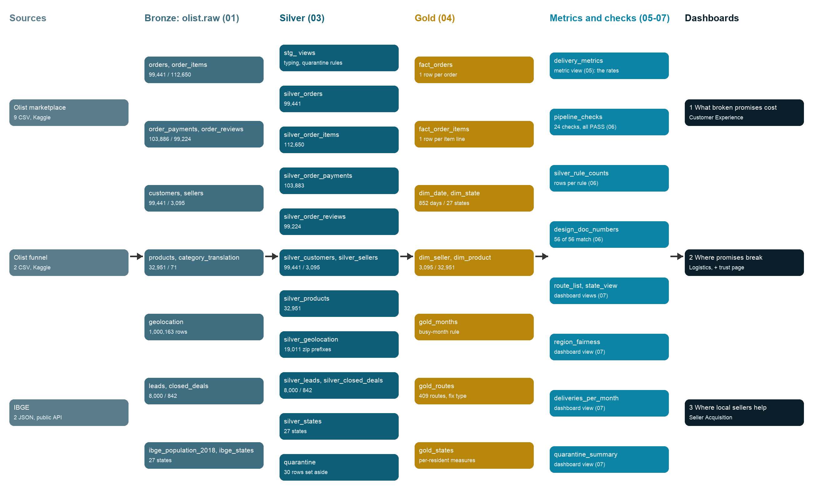
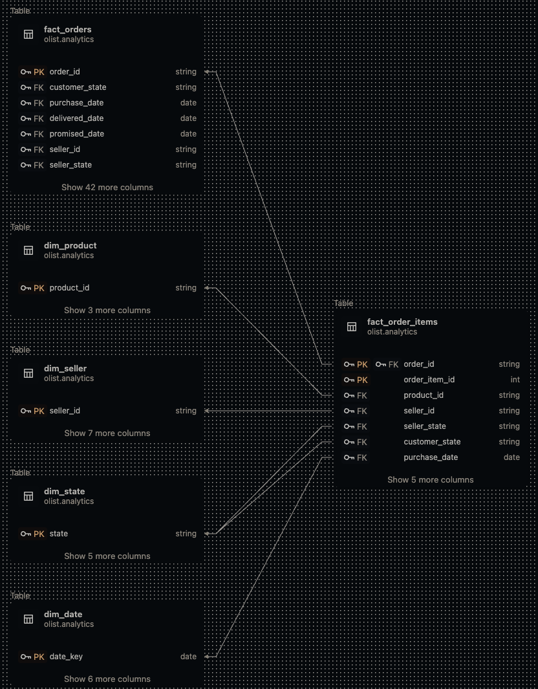
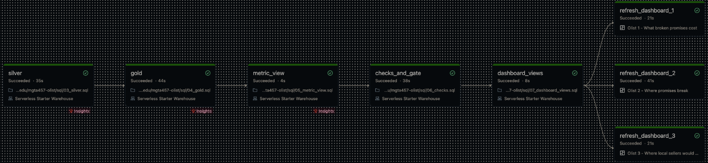

# Lineage map

Every number on the dashboards comes from 13 source files through the SQL scripts 00 to 07, and every step is a table or view you can open in Catalog Explorer. Read the map from left to right.

## Table by table

| Step | Script | Reads | Writes | Grain |
| --- | --- | --- | --- | --- |
| Setup | `00_setup.sql` | nothing | catalog `olist`, schemas `raw` and `analytics`, volume `landing_zone` | |
| Bronze | `01_load_raw.sql` | the 13 files in the volume | 13 tables in `olist.raw`, every CSV column as text | as delivered |
| Profile | `02_profile_bronze.sql` | `olist.raw` | nothing (read-only, 23 queries with expected values) | |
| Silver | `03_silver.sql` | `olist.raw` | `stg_` views (typing and the quarantine rules), 11 `silver_` tables (the other rules), `quarantine` | one row per source key |
| Gold | `04_gold.sql` | Silver | `fact_orders`, `fact_order_items`, `dim_date`, `dim_state`, `dim_seller`, `dim_product`, `gold_months`, `gold_routes`, `gold_states`, and their primary and foreign keys | order; item line; day; state; seller; product; month; route; state |
| Metrics | `05_metric_view.sql` | `fact_orders`, joined to `dim_state` twice (customer and seller) and to `dim_date` | `delivery_metrics` | formulas, not rows |
| Checks | `06_checks.sql` | raw, Silver, Gold, metric view | `pipeline_checks`, `silver_rule_counts`, `design_doc_numbers` | one row per check, rule or number |
| Dashboard views | `07_dashboard_views.sql` | Gold, the metric view and the quarantine | `route_list`, `state_view`, `region_fairness`, `deliveries_per_month`, `quarantine_summary` | route; state; region; month; reason |
| Dashboards | `dashboards/build_dashboards.py` | the metric view, the 07 views, and the check views `pipeline_checks` and `silver_rule_counts` | three published AI/BI dashboards | |
| Robustness | `08_robustness.sql` | Gold | nothing (read-only, 2 queries with expected values) | |
| Rebuild job | `jobs/olist_rebuild.json`, deployed by `tools/deploy_job.py` | the SQL files 03 to 07 | runs them in order, then refreshes the three dashboards | |

The dashboards read only the metric view, the views of `07_dashboard_views.sql` and two check views from `06_checks.sql`. They do no calculation: every rate a filter changes is a measure in `delivery_metrics`, and every rule (busy months, fix type, per-resident measures) is a column in Gold. On every build, check 22 compares the judged and broken orders behind each stored month, route and state rate, and each route's busy-month split, with the metric view.

## The star schema, declared

The Gold tables declare their keys in Unity Catalog: 9 primary keys and 15 foreign keys (`04_gold.sql`, section 10). Catalog Explorer draws the star from them; below, the item fact points to the order fact and to the product, seller, state and date dimensions. Unity Catalog does not enforce declared keys, so check 14 tests them on every build.

## The rebuild job

The job `Olist rebuild: Silver to dashboards` runs the SQL files 03 to 07 in order on the SQL warehouse, then refreshes the three published dashboards. The last statement of `06_checks.sql` is a gate: it fails when any pipeline check is not PASS, and a failed task stops the tasks after it, so the dashboard views and the refresh never run on a build that failed a check. The gate does not undo the tables already rebuilt. The job has no schedule, because the data does not change; run it by hand after a change to the SQL.

## Tracing one number back

The headline 8.6% on Dashboard 1, the share of judged orders whose promise broke:

1. The card asks the metric view for `MEASURE(broken_rate)`, defined as `SUM(is_broken) / SUM(is_judged)` over `fact_orders`.
2. In `fact_orders`, `is_judged` is true for 95,901 orders: bought from January 2017, promised by August 31, 2018, not canceled or unavailable, and not one of the 8 delivered orders without a delivery date. `is_broken` is 1 for 8,227 of them: delivered on a later calendar day than promised, or not delivered.
3. `fact_orders` takes the order, its dates and its status from `silver_orders`, where `stg_orders` read the five dates as timestamps and the promised date as a day (rule 3), and flagged the 8 orders (rule 4).
4. `silver_orders` comes from `olist.raw.orders`, the file `olist_orders_dataset.csv` exactly as downloaded from Kaggle (SHA-256 in `docs/sources.md`).

Check 19 of `pipeline_checks` confirms the metric view and `fact_orders` agree (95,901 judged, 8,227 broken), and `design_doc_numbers` confirms the 8.6% printed in the design document.
