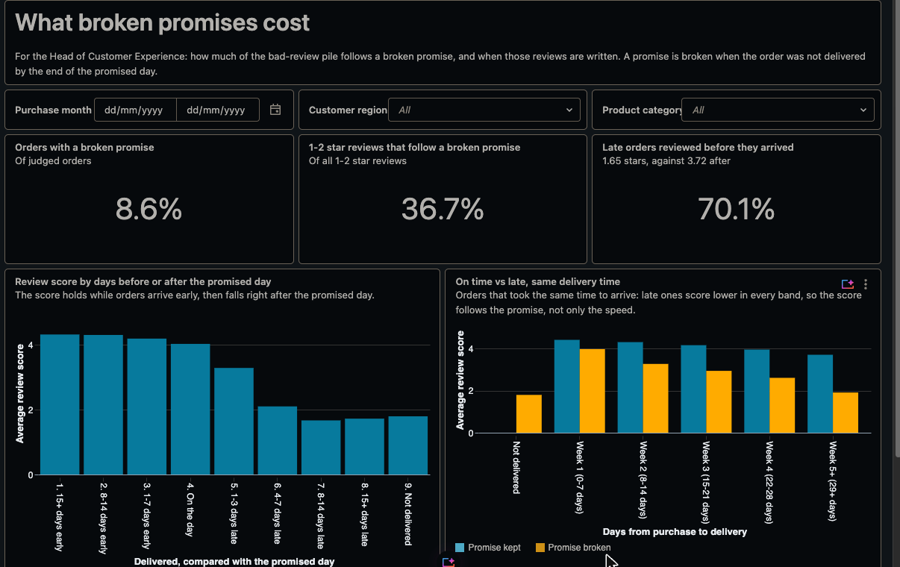
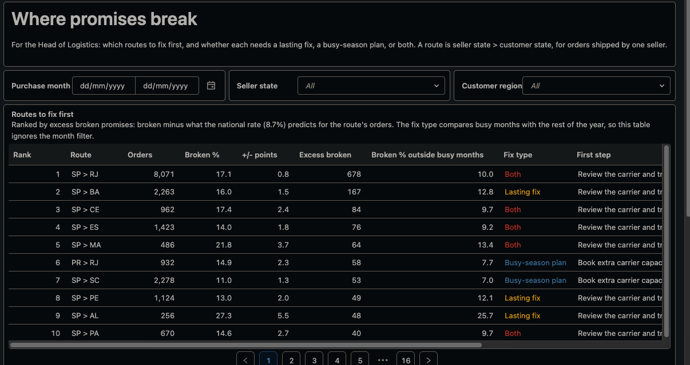
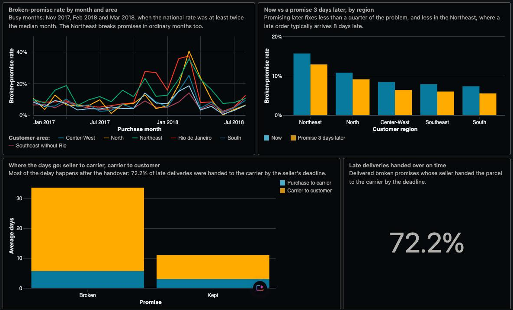
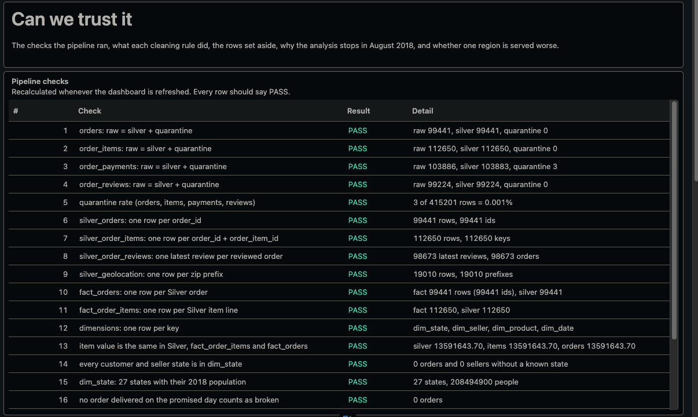

# Project overview

## The question and the answer

Olist lets small Brazilian shops sell on the big marketplaces, and its carriers deliver the orders. Every customer sees a promised delivery date at checkout. We asked where Olist breaks that promise, what a broken promise costs, and what Olist should fix first.

- **What it costs.** 8.6% of orders broke their promise, but they drew 36.7% of the 1 and 2 star reviews. 70.1% of late orders were reviewed before the parcel arrived, at 1.65 stars against 3.72 after.
- **Where it happens.** One route, Sao Paulo to Rio de Janeiro, has 678 more broken promises than the national rate predicts, more than the next nine routes together (637). The Northeast breaks promises in ordinary months too; three busy months hold 22.1% of orders but 42.9% of broken promises.
- **What to fix first.** Promising three days later only brings the rate from 8.6% to 6.6%, and 72.2% of late parcels reached the carrier on time, so the fix is on the routes and the carriers. Rio buys almost as much per resident as Sao Paulo but has a quarter of its sellers; its local sellers broke 7.7% of promises against 17.1% for Sao Paulo sellers, which supports a measured recruiting pilot in Rio.

## What we deliver

| Deliverable | Where |
| --- | --- |
| Dashboard design document (5 pages, sketches, user flow) | `deliverables/olist_design_document.docx`, source `docs/design_doc.md` |
| Databricks lakehouse: curated Unity Catalog tables | catalog `olist`: `raw` (Bronze), `analytics` (Silver, Gold, metric view, checks) |
| SQL workflow (the transformation layer) | `sql/00_setup.sql` to `sql/07_dashboard_views.sql` |
| Three dashboards, 4 pages, 19 visuals | Databricks AI/BI (accepted by the professor in place of Power BI); files in `dashboards/` |
| Final documentation (this document) | `deliverables/olist_final_documentation.docx` |
| Presentation | `deliverables/olist_presentation.pptx` |
| Code | GitHub `rsm-aaljarallah/mgta457-olist` (private) |

## The three dashboards

Each dashboard has one reader, in the order of the story: what it costs, where it happens, what to change.

**Dashboard 1, What broken promises cost**, for the Head of Customer Experience: three cards and the review score by days early or late, and on-time against late orders at the same delivery time.

**Dashboard 2, Where promises break**, for the Head of Logistics: the routes to fix first with their fix type, the monthly rate by area, the "promise later" test, and where the days go.

Its second page, **Can we trust it**, shows every pipeline check, what each Silver rule did, the rows set aside, why the analysis stops in August 2018, and the fairness check by region.

**Dashboard 3, Where local sellers would help**, for the Head of Seller Acquisition, here filtered to Rio de Janeiro customers.

## How to run it

1. In Databricks, run `sql/00_setup.sql`, upload the files (`tools/fetch_ibge.sh`, then `tools/upload_raw.sh`), and run `sql/01_load_raw.sql`.
2. Run `sql/02_profile_bronze.sql` (read-only; every query lists the value it should return).
3. Run `sql/03_silver.sql` to `sql/07_dashboard_views.sql` in order.
4. Check `olist.analytics.pipeline_checks`: every row must say PASS before a dashboard is refreshed.
5. Build and publish the dashboards: `python3 dashboards/build_dashboards.py`, then `python3 tools/deploy_dashboards.py`. A teammate can instead import the three `.lvdash.json` files.

## Result of the last build

All 21 pipeline checks pass. 3 of 415,201 order, item, payment and review rows were set aside (0.001%), plus 33 location points outside Brazil. All 39 headline numbers of the design document are recomputed from Gold by `design_doc_numbers` and match.

## The rest of this document

The lineage map traces every table from the source files to the dashboards. The metric dictionary defines every number. The data dictionary lists every column. The data quality log gives the grain of each table, what the profile found and the 31 rules with their reasons. The AI usage log records every AI-assisted change and who reviewed it.
